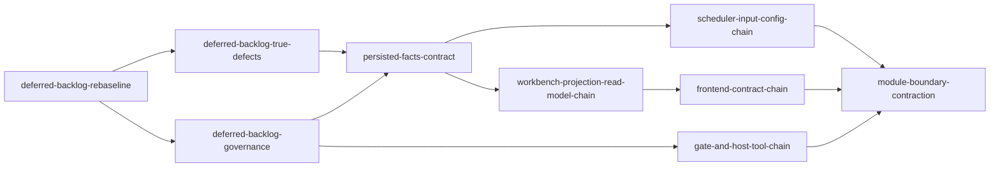

# 去过度防御与去冗余专项路线图

## 变更日志

- **2026-11-15 第 1 批完成**（`deferred-backlog-true-defects` → `done`，完成快照 `refs/backups/deferred-backlog-1-done` = `f93e78dc`）：
  - 9 条真缺陷与接手回归 H1 已修；#7 候选图权重按计划随第 3 批步骤 5 落地，#11 采用快照 gaps 不改代码、死路径在第 5 批步骤 2 删除。与原修法的差异：R04 的统一值域扩大到供应商默认周期（Codex 严审 r1 F1）；校准“建议值超存储值域”阻断原因经核为生产不可达，未加；H1 另删 2 个同类包装。
  - 验证：86 个测试文件 746 passed，前端生产构建与提交产物一致，`scan_over_defense --fail-on-new` 通过，死代码孤岛 98 → 97，其余基线不变；未跑日常门禁与全量门禁（用户明令），全量 `pytest -q` 在全部批次完成后后台分片跑一次。
  - 严审中转出的 12 条已写进审计 `execution-plan.md` 第 3～8 批的对应步骤（第 8 批新增步骤 8）。
- **2026-11-15 合并分片 09/10，第 0 批完成，第 1 批进行中**：
  - 审计新增分片 09（读取收口重构 16 份 Codex 复审终稿的记账放行全量对账：207 条发现，记入 51 条里 43 条出自各 Block 最后一轮）与分片 10（Block 6 完成后的台账增量重核：修掉 4、变形 3、仍在 71）。需要动作的 21 条记入、未记账、并入残留与需动作的驳回，已逐条落到 9 批的具体步骤；没有新增根源，只补了 M 的子机制与 R1/R2/R3/R5/R6 的证据。
  - 新增 8 项裁决（D2-3、D2-4、D3-9、D3-10、D5-9、D5-10、D5-11、D8-4），用户全部按推荐；裁决共 54 项。
  - 第 0 批完成：当前工作区重测新基数、台账重核、裁决收齐、仓库外三份清单收进审计目录、3 个只剩 `__pycache__` 的目录已删。重测发现接手回归 H1（7 个只剩测试调用的生产函数，`scan_over_defense --fail-on-new` 失败），归第 1 批。
  - 第 1 批进行中（开工备份 `refs/backups/deferred-backlog-1-start`）；候选图权重字段移到第 3 批随 v50 落地，采用快照 gaps 经探针撤回、转第 5 批清理。第 3 批加约束需升 Schema 到 v50，现有 v49 开发库与样例库重建。
- **2026-11-15 重排**：用户要求把各轮清理留下的“以后再修”条目统统按 blacklist 4 条拷问和 15 个母题往上推到根源，制定方案，等 Block 6 结束后统一执行。审计 `.codestable/audits/2026-11-15-deferred-backlog-root-causes/` 核了 228 行在册条目和三类信号池，得出 6 个产品根源加 1 个治理元根源。据此：
  - 原 C1～C5 五刀按信号类型切分，改为按事实链分 9 批；五个原条目在 `items.yaml` 里标 `dropped`，并写明取代者和理由。
  - 原版基数有 3 处失真：C2 把 2,270 处 `.get()` 当清理基数，抽样后真垃圾约 27%–40%；C4 列的 5 条测试债务早已退役；C5 的“256 处净减 70%”经全量定类只有约 8.7% 可删或可迁。
  - 原版“绝不删”清单里的 `scripts/run_quality_gate.py:149` `_safe_relpath`，经核实生产两端同源同盘，改为待裁决项（D7-1，推荐删）。
  - 原版快照在审计目录 `evidence/roadmap-2026-11-12-snapshot/`。
- **2026-11-12 创建**：五刀 C1～C5（已取代）。

## 1. 背景与目标

`aps-architecture-consolidation` 已经把主干职责收口。剩下影响长期理解和修改成本的，是模块内部多年累积的习惯性防御、平行实现、测试专用回退和迁移残留。2026-11-15 的审计证明：这些问题绝大多数不是“某人多写了一个 `.get()`”，而是**上游的保证没有交给下游**。所以本专项的目标从“删掉多少处信号”改为“在源头把保证交出来，让下游的防御失去存在理由，然后删掉它们”。

裁决标准仍是 blacklist 的 4 条拷问：删掉会怎样、上游是不是已经有了、这是外部边界还是内部受控结构、合法数据的意思变了没有。治理原则是《认知一致性》：同一种事情只有一条路，迁移全部调用者，清理旧实现与旁路。

## 2. 根源（详见审计 `root-causes.md`）

| 根源 | 一句话 | 主要落在 |
|---|---|---|
| R1 | 持久层事实（单版本、拒旧库、写入口严格）没有以 Schema 约束、准入断言、唯一读取函数交给读侧 | 第 3 批 |
| R2 | 准入/准备产物不定型：校验只放行或拒绝，不交出类型化结果 | 第 4～7 批 |
| R3 | 同一事实或规则没有唯一归属：平行投影、镜像实现、多份编解码 | 第 3、5、6、7、8 批 |
| R4 | 测试与生产走两套构造路径，倒逼生产保留回退与观测口 | 每批同步修，第 4、6 批建构造器 |
| R5 | 重构与迁移缺少收缩步骤 | 每批收尾 + 第 8 批 |
| R6 | 对象与作用域的所有权没有约定 | 第 4、5 批 |
| M | 治理口径让问题合法化、看不见或无限期推迟 | 第 0、2 批 |

## 3. 硬边界（2026-11-15 修订）

- **交付目标不变**：Win7 x64、Python 3.8、离线单机；宿主工具不进产品包。`scripts/run_quality_gate.py` 及其 `tools/` 依赖属于产品侧最终门禁，同样受 3.8 与 Windows 约束。
- **绝不删（真实边界与业务保护）**：
  - 外部 HTTP 请求与载荷准入；
  - Excel/CSV 文件导入解析；
  - 跨进程运行锁与维护排他锁；
  - SQLite 与持久归档的**首次**读取准入（只做一次，但要做到位）；
  - `sqlite_integrity → database → ensure_current_schema_contract → backup_restore` 备份恢复校验链；
  - `core/plugins/manager.py` 宿主无关的日志降级边界；
  - `snapshot_token` 读快照校验；
  - worker 领取、隔离计算、保存复核三段事务边界；
  - 完整关系闭包；
  - 全程精确量计算；
  - 命令回执的 `committed` 身份关联；
  - 算法断点克隆与 `shared_archive` 发布出口的那一次隔离拷贝。
- **持久存储与公开契约**：不再写“零变更”。裁决 G-1 已成立（同一库内归档形状唯一，形状变化即升 Schema 版本，旧库拒绝不迁移），第 3 批升到 v50，一次调整列、约束和档案键集，现有 v49 开发库与样例库重建。公开 DTO 恒值字段的删除（D5-5）、返回上下文信封统一（D6-2）属于公开形状变化，按裁决执行，并在同批更新前端与开发文档。
- **删改核查铁律**：
  - 改或删产品符号前，先用 `python3 -m tools.symbol_locator` 核清定义与引用，再 `rg` 一遍 `frontend/`、`tests/**/*.cjs`、`scripts/workbench/`；
  - 疑似死代码要动态或按协议核验，dataclass 钩子、SQLite UDF 回调、Protocol、魔术方法、鸭子阶段钩子不能盲删；
  - 删防御前必过 Q4 和母题 N、O。
- **不新增过渡层**：不加兼容壳、双轨开关（`prevalidated`、`strict_*=False`）或重导出垫片。

## 4. 跨批契约

1. **准入即定型**：边界函数返回不可变的已准入类型（Python 3.8 用 frozen dataclass、NamedTuple 或 TypedDict；JS 让 Contract 返回定型对象，并写保证清单），内部 API 只收已准入类型。各批都按这一条执行，不允许一批定型、另一批照旧传裸 dict。
2. **每件事一个归属模块**：工时值类型与 `sum_hours`、时间单一表示、枚举定义、`read_stored_json`、存储整数准入、`parse_ref`/`wire_int`/`new_ref`、身份行工厂、前端 `shared/contract/kit.js`、路由层共享 helper（含键集检查 `require_keys`）、日志底座、门禁复用协议。后一批发现需要同类能力时，直接复用前一批的归属模块，不另写一份。
3. **测试走生产同形构造**：删生产回退之前，先给测试换成 `tests/_support/` 里的生产同形构造器或前端真实 producer 夹具。“被测试锁定”不是保留理由，除非那条测试锁住的行为在生产里可达。
4. **每批收缩**：被替换的符号 `callers --deep` 归零才算完成；基线只减不增，同批刷新。
5. **验收**：以开工前备份 ref 为基准，用 blacklist 审本批每一行新增与改写（`tests/` 一起审）；再按事实链端到端审，最后做跨批一致性检查。门禁按用户口径跑“定向测试 + 适用的日常门禁”，如实写覆盖范围，不冒充全量。

## 5. 子条目与依赖

推荐执行顺序：0 → 1 → 2 → 7 → 3 → 4 → 5 → 6 → 8。第 7 批和第 3～6 批不共享文件，但门禁是其他批的验证手段，所以放在第 3 批之前串行做完。

| 批 | 条目 `slug` | 依赖 | 状态 | 核心交付 |
|---|---|---|---|---|
| 0 | `deferred-backlog-rebaseline` | Block 6 完成 | `done` | 当前工作区重测新基数、台账重核（分片 10）、记账放行全量对账（分片 09）、54 项裁决落定、仓库外清单收进审计目录 |
| 1 | `deferred-backlog-true-defects` | 0 | `done` | 真缺陷修复（候选图权重移第 3 批，采用快照 gaps 经探针撤回）+ 接手回归 H1；2026-11-15 完成，转入后续批次 12 条 |
| 2 | `deferred-backlog-governance` | 0 | `planned` | 扫描器隐式入口与棘轮、Protocol 声明、台账分类、待修池口径、复审放行口径（D2-4）、延迟环进基线（D2-3） |
| 7 | `gate-and-host-tool-chain` | 2 | `planned` | 门禁记录定型、JSON 一次准入、复用协议合一、退役 4,188 行旧脚本 |
| 3 | `persisted-facts-contract` | 1、2 | `planned` | 升 v50：Schema 约束与枚举一处定义、唯一存储读取、工时/时间单一表示（工时收成精确文本单列）、归档形状契约、读侧直取 |
| 4 | `scheduler-input-config-chain` | 3 | `planned` | 配置快照与排产输入定型、运行作用域对象、测试构造器、OR-Tools 去留 |
| 5 | `workbench-projection-read-model-chain` | 3 | `planned` | 准备包与投影输入定型、读模型单路径、表格列定义一份、资源池定型、多形态分型、编解码与身份行工厂一份、单调用方泛化与测试构造器 |
| 6 | `frontend-contract-chain` | 5 | `planned` | contract kit、定型 Contract、返回上下文一种形状、查询 hook、测试缝、别名 codemod |
| 8 | `module-boundary-contraction` | 4、6、7 | `planned` | 私有名正名、延迟环下沉与 history 包拆分、真死代码与重导出桶删除、日志底座、台账收窄、批量键集参数收口 |

每批的做法、验证与退出判据见审计 `execution-plan.md`；需要的裁决见审计 `decisions.md`。

## 6. 观察项

- 读取收口那条线原有 4 处回归，Block 6 后的现状（审计分片 10）：私有导入已修；history↔trial 硬环只改成了延迟 import，依赖没拆，由第 8 批拆 history 包；15 处裸 `json.loads` 由第 3 批迁移；`trial/preparation.py` 的 `saved_resources=None` 实际在区分两种模式，由第 5 批分型。裁决 G-5 已收尾，不再转告。
- Block 6 已做掉 `sqlite_udf` 版本回退与资源侧 `toolbar_counts`；`processing_hours` 只换了求和实现，出口仍 `float()`。Block 6 尚未提交，提交内容若与当前工作区不同，按审计分片 10 的方法增量重核。
